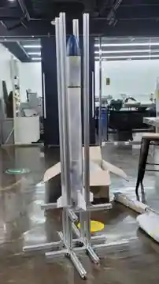
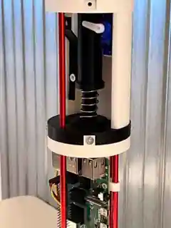
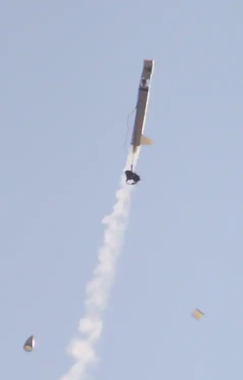
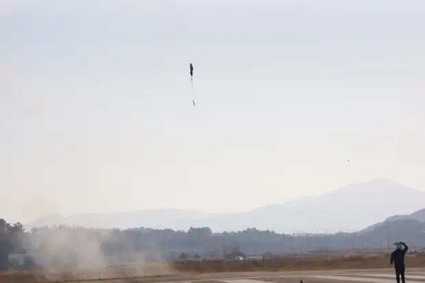

# 로켓 비행전자·낙하산 전개 제어 시스템

> **2024 가천대학교 로켓동아리 GOAT 전자부 · 실제 제작·시험 및 개인 담당 영역 정리**

실제 발사체에서 **센서 데이터 수집 → 하강 판단 → 낙하산 전개 장치 제어**가 이어지도록 설계·시험한 팀 프로젝트입니다. 센서값의 일시적인 흔들림이 오작동으로 이어지지 않도록 판단 조건을 설계한 경험을 코드와 테스트로 보여줍니다.

전체 시스템은 **GOAT 전자부 팀 공동개발**이며, 이 저장소에서는 제가 면접에서 구현 수준으로 설명할 수 있는  
**센서 연동 → 비행 데이터 처리 → 고도 기반 하강 판단 → 낙하산 전개 장치 제어 → 실제 발사체 통합 테스트**를 중심으로 정리했습니다.

---

## 실제 제작·시험 사진

| 로켓 조립·실물 | 비행전자 장치 | 비행 중 낙하산 사출 |
|:---:|:---:|:---:|
|  |  |  |
| 실제 조립 모습 | Raspberry Pi 기반 탑재 장치 | 실제 비행 중 분리·사출 장면 |

**추가 비행 사진 — 낙하산 전개 이후 하강 장면**



[이미지 크게 보기](assets/photos/parachute-in-flight.webp)

> 사진은 GOAT 팀 프로젝트 자료입니다. 이미지에 나온 모든 부품과 시스템을 개인이 단독 제작한 것은 아닙니다. GitHub에는 웹용 미리보기 해상도로 올렸습니다.


## 1. 프로젝트 개요

BMP280·GPS·9DOF IMU에서 비행 데이터를 수집하고 Raspberry Pi에서 처리한 뒤,  
**고도 변화로 하강 상태를 판단하여 Relay/Servo 기반 낙하산 전개 장치를 제어하는 비행전자 시스템**입니다.

```text
BMP280 (고도) ───── I2C ──┐
NEO-M8N GPS ────── UART ──┼──> Raspberry Pi
EBIMU 9DOF ─────── UART ──┘
                              │
                              ▼
                        Sensor Processing
                              │
                              ▼
                         Descent Detection
                              │
                              ▼
                         GPIO / PWM
                              │
                              ▼
                         Relay / Servo
                              │
                              ▼
                     Parachute Deployment
```

---

## 2. 담당 역할

- 비행에 사용할 **센서 선정 및 인터페이스 연동**
- BMP280·GPS·9DOF IMU의 **센서 데이터 수집·처리**
- **고도 기반 낙하산 사출 판단 로직 개발·검증**
- 회로 및 전자부 시스템 통합
- 실제 발사체 통합 테스트 참여
- **2024 한국추진공학회 춘계학술대회 NURA 세션(제주)** 참가
- **전국대학교로켓학술대회(대전)** 참가

> 본 프로젝트는 팀 프로젝트이며, 전체 Avionics 코드의 단독 개발을 주장하지 않습니다.

---

## 3. 실행 가능한 판단 로직과 테스트

낙하산 사출 판단 로직은 원본 팀 코드 전체를 복제하지 않고 독립 예제로 재구성했습니다. 센서값의 일시적인 변동을 바로 사출 신호로 사용하지 않는 구조를 확인할 수 있습니다.

```bash
python examples/descent_detector.py
python -m pip install pytest
python -m pytest -q
```

테스트에서는 하강 확인 횟수, 고도 기준 미달, 센서값 일시 변동, 유효하지 않은 입력을 확인합니다. GitHub Actions에서 변경 시마다 실행하며, [실제 테스트 기록](https://github.com/Westzer00/rocket-avionics-case-study/actions)에서 결과를 확인할 수 있습니다.

## 4. 사용 기술

| 구분 | 기술 |
|---|---|
| Platform | Raspberry Pi |
| Language | Python |
| Sensors | BMP280, NEO-M8N GPS, EBIMU 9DOF |
| Communication | I2C, UART / Serial |
| Control | GPIO, PWM, Relay, Servo |
| Data | MySQL, multiprocessing Queue |

---

## 5. 센서 구성

| 센서 | 용도 | 인터페이스 | 주요 데이터 |
|---|---|---|---|
| BMP280 | 고도 측정 | I2C | altitude |
| NEO-M8N GPS | 위치 측정 | UART / Serial | latitude, longitude |
| EBIMU 9DOF | 자세/운동 정보 | UART / Serial | roll, pitch, yaw, xyz |

센서별 데이터 수집은 별도 Process와 Queue를 활용하는 구조로 구성되어,  
메인 로직에서 최신 센서값을 받아 저장 및 상태판단에 사용할 수 있도록 했습니다.

---

## 6. 고도 초기값 보정

발사 직후 센서의 순간적인 흔들림과 발사지점의 절대고도 영향을 줄이기 위해  
초기 고도값을 여러 번 측정해 평균을 구하고 이를 기준고도로 사용했습니다.

```text
상대 고도 = 현재 측정 고도 - 초기 기준 고도
```

이를 통해 발사지점을 기준으로 비행 중 고도 변화를 판단할 수 있도록 했습니다.

---

## 7. 고도 기반 하강 판단

단일 고도값이 순간적으로 감소했다고 바로 사출하지 않고,  
**Moving Average + 연속 하강 확인 조건**을 적용했습니다.

```text
Raw Altitude
     │
     ▼
유효 범위 확인
     │
     ▼
최근 10개 Moving Average
     │
     ▼
사출 가능 고도(100m 이상) 확인
     │
     ▼
이전 평균 > 현재 평균 ?
     │
     ▼
연속 하강 Count 증가
     │
     ▼
5회 연속 하강 확인
     │
     ▼
Deployment Decision
```

팀 코드에서 확인되는 주요 조건은 다음과 같습니다.

| 항목 | 값 |
|---|---:|
| Moving Average Window | 10 samples |
| Minimum Deployment Altitude | 100 m |
| Falling Confirmation | 5 consecutive checks |

이 구조는 진동이나 센서 노이즈로 인해 고도값이 한 번 튀는 상황에서  
낙하산이 잘못 전개될 가능성을 줄이기 위한 판단 방식입니다.

간소화한 예제 코드는 [`examples/descent_detector.py`](examples/descent_detector.py)에서 확인할 수 있습니다.

---

## 8. 낙하산 전개 장치 제어

하강 상태가 확정되면 판단 결과를 Raspberry Pi의 **GPIO/PWM 출력**과 연결해  
Relay와 Servo를 이용한 낙하산 전개 장치를 제어하도록 구성했습니다.

```text
Descent Detection
        │
        ▼
       GPIO
      /    \
   Relay   PWM
            │
            ▼
          Servo
            │
            ▼
   Parachute Deployment
```

---

## 9. 최종 사출 조건으로 사용하지 않은 기능

원본 팀 코드에는 다음 기능의 구현 흔적도 존재합니다.

- IMU 자세 기반 사출 판단
- GPS/위치 기반 Critical Area 판단

하지만 확인한 최종 코드에서는 해당 경로가 **실제 최종 사출 Trigger로 활성화되어 있지 않았기 때문에**,  
이 저장소에서는 완성 기능으로 주장하지 않습니다.

---

## 10. 파일 구조

```text
rocket-avionics-case-study/
├── README.md
├── CONTRIBUTION.md
├── examples/
│   └── descent_detector.py
├── tests/
│   └── test_descent_detector.py
├── docs/
│   ├── architecture.md
│   ├── deployment-logic.md
│   └── change-log.md
├── assets/
│   ├── README.md
│   └── photos/
│       ├── rocket-assembly.webp
│       ├── avionics-hardware.webp
│       ├── parachute-deployment.webp
│       └── parachute-in-flight.webp
└── .github/workflows/
    └── tests.yml
```

`examples`는 독립 재현 로직, `tests`는 검증 코드, `docs`는 설계와 변경 이력, `assets/photos`는 공개 가능한 팀 프로젝트 사진입니다.

---

## 11. 원본 팀 저장소

전체 프로젝트 원본은 GOAT 전자부 팀 Repository에서 확인할 수 있습니다.

**AvionicsOfGOAT/2024-avionics-and-ground-system**
https://github.com/AvionicsOfGOAT 

이 저장소는 팀 코드를 복제하기 위한 목적이 아니라,  
**개인 담당 영역과 시스템 이해도를 기술적으로 정리한 프로젝트 포트폴리오**입니다.

---

## 12. 사진·코드의 공개 범위

- 실제 발사체 제작·시험에서 촬영한 사진을 웹용 이미지로 최적화했습니다. 사출 사진은 사용자가 제공한 원본을 검토해 다시 업로드했습니다.
- 프로젝트 기록과 담당 역할은 [CONTRIBUTION.md](CONTRIBUTION.md)에서 확인할 수 있습니다.
- 사진과 코드 모두 내부 연락처, 인증정보 및 비공개 자료를 공개하지 않는 범위에서 정리했습니다.
- 변경 내역은 [docs/change-log.md](docs/change-log.md)에 남깁니다.
